<div align="center">

<picture>
  <source media="(prefers-color-scheme: dark)" srcset="./dark.svg">
  <source media="(prefers-color-scheme: light)" srcset="./light.svg">
  
</picture>

<br>

<a href="https://himanshunagapure.github.io/himanshu-portfolio/"></a>
<a href="https://www.linkedin.com/in/hnagapure/"></a>
<a href="mailto:himunagapure114@gmail.com"></a>


</div>

<br>

## `whoami`

```python
class Himanshu:
    role      = "AI Engineer (Generative AI) @ AIQoD"
    based_in  = "Nagpur, Maharashtra, India"
    education = "B.E. Computer Science, GCOE Nagpur (2022)"
    focus     = ["Agentic AI", "Multi-agent orchestration", "RAG pipelines", "MCP"]
    stack     = ["Python", "LangGraph", "FastAPI", "AWS"]
    certified = ["AWS Certified Cloud Practitioner", "Machine Learning (Coursera)"]

    def building(self):
        return "AI systems that turn natural language into working software"
```

<br>

## What I build

<table>
<tr>
<td width="50%" valign="top">

### 🧩 Orkestrix
**AI-powered screen & workflow builder**

Turns natural-language prompts into working Angular screens with synchronized Python backend APIs, then chains screens and tools into full app pipelines using LangGraph.

<sub>`Python` · `LangGraph` · `FastAPI` · `MongoDB` · `Angular` · `AWS`</sub>

</td>
<td width="50%" valign="top">

### 🏦 MAS Compliance Checker
**RAG-based compliance reporting**

Compares a document against bank regulations and produces a scored compliance report in under 60 seconds.

<sub>`RAG` · `Pinecone` · `LLMs` · `Python`</sub>

</td>
</tr>
<tr>
<td width="50%" valign="top">

### 🎯 Lead Generation System
**Automated prospecting engine**

Scrapes the web, forums and social media using publicly available data to surface potential clients.

<sub>`Playwright` · `BeautifulSoup` · `LLM extraction`</sub>

</td>
<td width="50%" valign="top">

### 🤖 Modular AI Agent Ecosystem
**Autonomous tool generation & selection**

Agents that generate and pick their own tools and orchestrate workflows end to end.

<sub>`LangGraph` · `MCP` · `Multi-agent`</sub>

</td>
</tr>
<tr>
<td width="50%" valign="top">

### 📄 AI-SmartScan
**AI resume analyzer**

Gives feedback, a compatibility score, missing keywords, strengths and course recommendations. Deployed with CI/CD.

<sub>`Streamlit` · `Gemini` · `Docker` · `GitHub Actions` · `AWS EC2`</sub>

</td>
<td width="50%" valign="top">

### 🧭 NavGo
**Indoor navigation Android app**

Led a team building real-time location tracking and optimized pathfinding for campus premises, cutting navigation time for new visitors by 40%.

<sub>`Java` · `Android Studio` · `Git`</sub>

</td>
</tr>
</table>

<!-- Add repo links, e.g. [View repo →](https://github.com/himanshunagapure/REPO) under each card as projects go public -->

<br>

## Tech stack

<div align="center">


<br><br>


</div>

<br>

## GitHub stats

<div align="center">

<picture>
  <source media="(prefers-color-scheme: dark)" srcset="https://github-readme-stats.vercel.app/api?username=himanshunagapure&show_icons=true&theme=tokyonight&hide_border=true&bg_color=00000000&count_private=true">
  
</picture>
<picture>
  <source media="(prefers-color-scheme: dark)" srcset="https://github-readme-stats.vercel.app/api/top-langs/?username=himanshunagapure&layout=compact&theme=tokyonight&hide_border=true&bg_color=00000000">
  
</picture>

<picture>
  <source media="(prefers-color-scheme: dark)" srcset="https://streak-stats.demolab.com?user=himanshunagapure&theme=tokyonight&hide_border=true&background=00000000">
  
</picture>

</div>

<br>

## Contribution snake

<div align="center">

<picture>
  <source media="(prefers-color-scheme: dark)" srcset="https://raw.githubusercontent.com/himanshunagapure/himanshunagapure/output/github-snake-dark.svg">
  
</picture>

</div>

<br>

## Experience

<details open>
<summary><b>AI Engineer (Generative AI)</b> · AIQoD · May 2025 – Present</summary>
<br>

- Built a full-stack screen builder that generates functional screens from prompts
- Designed a modular AI agent ecosystem with autonomous tool generation, selection and workflow orchestration
- Shipped a RAG-based compliance checker that scores documents against bank regulations in under 60 seconds
- Built a lead-generation system that scrapes public web, forum and social data

</details>

<details>
<summary><b>Data Science Intern</b> · Unified Mentor · Dec 2024 – Feb 2025</summary>
<br>

- Built and optimized ML models with Python and SQL, improving data accuracy by 20%
- Delivered insights through the MediGuide and Retention360 projects using Power BI

</details>

<details>
<summary><b>Data Analyst Intern</b> · Internship Studio · Jun – Jul 2024</summary>
<br>

- Handled preprocessing, feature engineering and modeling, improving prediction accuracy by 25%
- Built interactive dashboards in Power BI and Excel

</details>

<details>
<summary><b>Associate Software Engineer Trainee</b> · SevenX · Feb – Jun 2022</summary>
<br>

- Built reusable Salesforce LWC components, improving UI efficiency by 20%
- Optimized API integrations, reducing data retrieval time by 30%

</details>

<br>

## Education & certifications

| | |
|---|---|
| 🎓 **B.E. Computer Science** | Government College of Engineering, Nagpur · 2018 – 2022 · 87% |
| ☁️ **AWS Certified Cloud Practitioner** | Amazon Web Services |
| 🧠 **Machine Learning** | Coursera |

<br>

## Let's connect

Open to conversations about agentic AI, RAG systems and building products with LLMs.

<div align="center">

<a href="https://www.linkedin.com/in/hnagapure/"><b>LinkedIn</b></a> · <a href="https://himanshunagapure.github.io/himanshu-portfolio/"><b>Portfolio</b></a> · <a href="mailto:himunagapure114@gmail.com"><b>Email</b></a>

<br><br>


</div>
